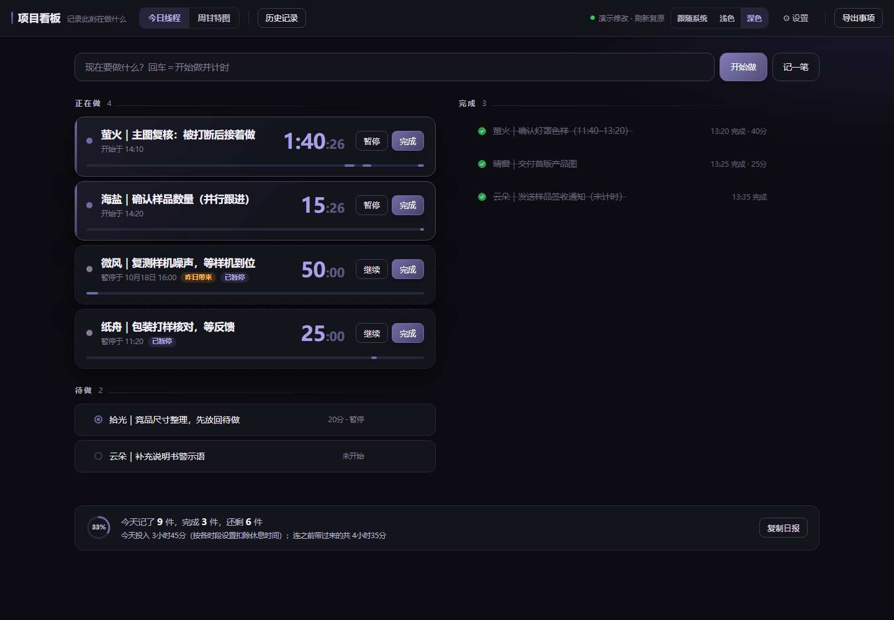
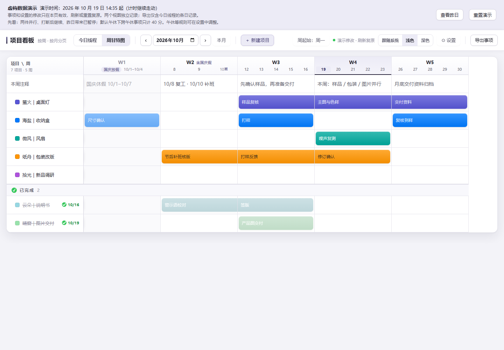

# Day Threads 今日线程｜被打断后，找回刚才那件事

**消息回完、电话挂断，刚才做到哪了？**

[English](README.en.md)

**[在线体验（虚构数据，可重置）](https://mackeychan12-tech.github.io/day-threads/demo.html)**

方案改到一半，同事发来消息；回完消息，又去处理了一个临时问题。等重新坐回来，刚才在做什么、下一步准备做什么，已经有点想不起来了。

今日线程把手头的事留在眼前：被打断时暂停，回来再继续，保留每次投入的时段；今天没做完，明天接着做。

这是一个支持分段计时、跨天接续和独立周甘特图的本地任务管理工具。不需要注册账号、安装依赖或配置后端。主程序是一个 HTML 文件，实际数据保存在你选择的文件夹里。



## 给回来继续做的自己留条线索

例如，方案复核到一半要去处理别的事，可以双击事项文字，留一句「方案复核：预算已核，接着检查交期」，再暂停。

回来时，这句话提醒你接下来做什么；点继续，之前的计时时段也会保留。这里的进度线索由你写下，工具保存事项文字和时段，不自动记录文档内容或光标位置。

适合希望减少维护工作、自己掌握数据的个人使用。两个视图各自记录，没有自动关联或同步任务进度。

## 可以做什么

- **今日线程**：正在做、待做、完成三区；拖动切换状态，暂停后继续，保留多段工作时段。默认允许多件事同时计时，可在设置中关闭。
- **跨天接续**：默认将历史未完成事项带到今天，并暂停计时，等你手动继续；可分别查看当天投入和累计投入，也可关闭自动带入。
- **回看与日报**：从日历查看历史记录；历史只读，一键复制当天完成和进行中的事项。
- **周甘特图**：按月分页，点击或拖涂占用周；支持整周注释、项目周备注、排序、完成分组和顺延下月。
- **工作日显示**：可设置每周工作日、周起始日及指定日期的上班／休息状态。默认启用内置 2025、2026 年中国节假日与调休，跨月部分淡化显示；内置安排不自动更新。
- **本地数据文件**：Chrome、Edge 可以连接同一个文件夹中的 `看板数据.json`；切回页面时检查更新，保存前发现版本冲突会让你选择，并下载未采用的一份作为备份。
- **主题分段选项**：在顶部直接选择跟随系统、浅色或深色，也可在设置中调整。



## 先试一下

下载仓库并解压，用桌面版 Chrome 或 Edge 打开 [demo.html](demo.html)。演示页也可以作为静态页面托管。

`demo.html` 仅用于体验；日常记录请打开 `index.html`。正式使用页不包含演示数据、演示提示或「重置演示」按钮。

演示全部使用虚构数据，包含被打断后继续的事项、昨日结转、跨午休计时、待做和完成混合状态，以及节假日、补班和跨月项目安排。

演示时钟从 **2026 年 10 月 19 日 14:35** 起走时。刷新或点击演示页的重置按钮，会恢复初始事项与设置。演示不连接、不读取、不写入实际数据文件，存储与正式使用页隔离。它适合体验交互，不能用来保存真实工作记录。

## 开始实际使用

1. 下载并解压仓库，将文件放在自己准备长期保存的位置。
2. 用桌面版 Chrome 或 Edge 打开 [index.html](index.html)。
3. 点击「选择看板所在的文件夹」，选择包含 `index.html` 的文件夹，并允许读写。
4. 连接后会在该文件夹中创建或读取 `看板数据.json`。看到「已存到数据文件」后，即可正常使用。

换浏览器时，打开同一份 `index.html`，选择同一个文件夹。浏览器可能要求重新授权。首次连接旧浏览器数据时，页面会提示迁移或下载未采用的数据备份。

正式使用页依赖浏览器的本地文件夹读写能力；没有这项能力的浏览器会显示提示。演示页不需要文件夹授权。

## 按自己的习惯设置

点击页面「设置」可调整以下规则；默认值延续原有使用方式。

[查看设置界面](docs/images/settings.png)

| 设置 | 默认与作用 |
|---|---|
| 每日休息 | 默认扣除 12:00–13:00；可关闭，或改为一段同日休息时间，开始时间必须早于结束时间，不支持跨午夜 |
| 每周工作日与周起始 | 默认周一至周五工作，用于周甘特表头；周起始默认周一，同时用于甘特图和历史日历 |
| 中国节假日与补班 | 默认启用内置 2025、2026 年安排，可关闭；未录入年份按已设每周工作日显示并提示 |
| 指定日期 | 可单独设为上班或休息，优先于内置节假日及每周工作日 |
| 未完成事项自动带入 | 默认开启；带到今天后仍先暂停，等待手动继续 |
| 多件同时计时 | 默认开启；可选择一次只运行一件 |
| 输入框回车 | 默认开始做并计时；也可改为只记入待做 |
| 打开时的视图 | 默认今日线程，也可先打开周甘特图 |
| 动画偏好 | 默认跟随系统，可调整页面动画 |

工作日判断顺序为「指定日期 → 内置节假日与补班（启用时）→ 每周工作日」。这些日期设置只影响周甘特表头，**不会让计时器在下班、周末或节假日自动停止**。

休息设置只影响后续计时时段。调整时，正在运行的事项会在同一时刻分段后继续；之前的时段保留当时的休息规则。旧记录没有保存休息规则时，仍按原来的 12:00–13:00 计算，避免历史投入随新设置改变。

除主题只保存在当前浏览器外，以上规则随看板数据文件和完整备份保存。演示页的设置只在当前页面内有效，刷新会复原。历史只读、文件连接、冲突选择与备份等保护规则仍保留，设置并非开放所有内部参数。

## 数据与使用边界

### 备份、导入与恢复

- **完整备份**：待「已存到数据文件」出现后，复制 `看板数据.json` 到自己的备份位置；里面包含甘特图、今日线程和看板设置。
- **页面「导出」按钮**：仅导出今日线程的全部历史事项，**不包含甘特图**。
- **导入整份看板备份**：替换甘特图与今日线程；导入事项备份只替换今日线程；旧版甘特备份只替换甘特图。导入前先保留当前数据副本，导入不是合并。
- **冲突处理**：保留文件里的数据，或用当前页面覆盖；另一份通过浏览器下载为备份。请确认下载实际保存成功。

浏览器里也会保留缓存，但长期保管和迁移请使用数据文件。不要把自己的 `看板数据.json`、导出文件、备份或含真实工作信息的截图提交到公开仓库。

### 关于共享与计时

共用文件方便在浏览器之间切换，也可用于已有共享文件夹的环境；它没有账号、权限控制、实时合并或并发写入保证。多个人同时编辑同一份数据时，仍可能互相覆盖，请避免同时修改。

计时按真实时钟计算，扣除该时段保存的每日休息规则；默认休息为 **12:00–13:00**。它不按上下班、周末或节假日停止。允许多件事同时计时时，各件事分别累加，因此「投入」总和可能超过真实经过时长，适合回顾工作，不适合作为考勤或精确专注时长。

「撤销完成」可以把事项放回待做，项目也可恢复为进行中；普通删除和涂改没有通用撤销。历史查看不是版本回滚。项目顺延下月只复制名称与颜色，下月周安排留空。

## 开发与贡献

日常使用直接打开 HTML，无需构建、Python 或 Node.js。界面使用系统字体，没有运行所需的第三方 JavaScript 依赖。

维护代码时，以本目录的 `index.html` 为主程序源文件；修改演示场景则编辑 `scripts/build_demo.py` 中的虚构样例。不要单独修改生成的 `demo.html`、`demo-data.json` 或 `favicon.svg`，重新生成会覆盖这些文件。

在仓库根目录使用 Python 3.10 或以上版本重新生成演示，并检查生成文件一致性：

```sh
python scripts/build_demo.py
python scripts/build_demo.py --check
```

脚本默认读取同目录包内的 `index.html`，不需要原作者的工作目录。修改后，有 Node.js 18 或以上版本时，运行不需安装依赖的逻辑回归：

```sh
node tests/settings.test.cjs
```

再用浏览器打开正式页和演示页，验证实际操作；逻辑测试不能代替页面及数据保存检查。

请先阅读 [贡献说明](CONTRIBUTING.md)。展示与录屏可参考 [演示脚本](docs/演示脚本.md)，GitHub 名称、简介与关键词可直接使用 [填写内容](docs/GitHub填写内容.md)，发布介绍可参考 [发布文案草稿](docs/发布文案.md)。

## 许可证

本项目采用 [MIT 许可证](LICENSE)。Copyright © 2026 Day Threads contributors。
